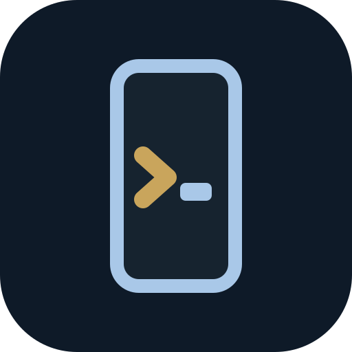
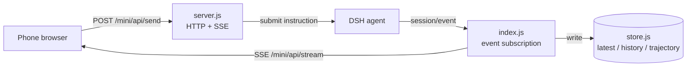

<p align="center">
  
</p>

<h1 align="center">dsh-remote-lite</h1>

<p align="center">
  DSH on your phone — pair over LAN or a Cloudflare tunnel, no command line required.
</p>

<p align="center">
  <a href="LICENSE"></a>
  <a href="package.json"></a>
  <a href="package.json"></a>
  <a href="https://github.com/coderxxw/dsh-remote-lite/pulls"></a>
</p>

<p align="center">
  <b>English</b> | <a href="README.md">简体中文</a>
</p>

---

`dsh-remote-lite` is a mobile remote control for DSH. It starts an HTTP + SSE server on the host (default `:3090`); scan the pairing QR code and a phone browser can browse workspaces and sessions, send instructions, approve tool calls, and switch models and permission presets. At home the LAN route is enough; away from home the same page is reachable through a Cloudflare tunnel.

The plugin does **not** proxy the desktop UI — the phone gets instructions and answers, with intermediate steps expanded on demand. It registers no system service, does not start at boot, and does not touch the hosts file: when DSH exits, the server stops.

## Table of contents

- [Features](#features)
- [Requirements](#requirements)
- [Installation](#installation)
- [Quick start](#quick-start)
- [Usage](#usage)
- [Configuration](#configuration)
- [How it works](#how-it-works)
- [API](#api)
- [FAQ](#faq)
- [Known limitations](#known-limitations)
- [Roadmap](#roadmap)
- [Contributing](#contributing)
- [Acknowledgements](#acknowledgements)
- [License](#license)

## Features

- **Two transports.** Plaintext HTTP on the LAN works out of the box; the public route uses a Cloudflare tunnel, giving you HTTPS and a fixed hostname.
- **Zero-command-line tunnelling.** Paste one Cloudflare API token and the plugin creates the tunnel, writes the ingress rule, writes the DNS record and starts `cloudflared`.
- **Three display modes.** Frame shows only the latest answer, Chat shows full turns, Full also expands every step's reasoning and tool calls.
- **A complete remote surface.** Send instructions (queue or steer while a turn is running), slash commands, file and photo upload, tool approvals, answers to questions, subagent inspection and follow-ups, model and permission switching.
- **Session navigation.** Workspace → session tree, create sessions or workspaces, browse directories to pick a location; history is backfilled from session logs the plugin never witnessed.
- **Lock-screen push.** Bark, ntfy and Telegram channels, plus service-worker system notifications (HTTPS only).
- **Desktop view.** A built-in reverse proxy serves the desktop GUI on the phone, for the settings pages the mobile UI cannot reach.
- **Housekeeping.** Long-press a session row to archive that conversation, or long-press a workspace title to archive every conversation under it — or delete the workspace outright.
- **Verifiable runtime.** `/mini/api/version` returns a build fingerprint, so you can tell whether the process answering you is the code you just edited.

## Requirements

| Dependency | Version |
| --- | --- |
| Node.js | `^22.19.0 \|\| >=24.0.0` |
| DSH | `>=0.1.5-rc.2 <1.0.0` |

When the runtime does not match, DSH refuses to load the plugin and asks for an exact-version exemption.

## Installation

This package is **not published to npm**. Two install paths exist, and both require an explicit `--profile` — `dsh plugin` does not infer the target profile.

```sh
# From GitHub (tracks the latest commit on main)
dsh plugin --profile web add github:coderxxw/dsh-remote-lite

# From a local path (development; edits take effect on restart)
dsh plugin --profile web add link:/path/to/dsh-remote-lite
```

On Windows the local form is `link:D:/path/to/dsh-remote-lite`.

Confirm the entry landed in the profile's `dsh.profile.bundles`:

```sh
node -e "console.log(require(process.env.HOME + '/.dsh/profiles/web/package.json').dsh.profile.bundles)"
```

Without that entry the plugin will not load — and there is **no error**, just silence.

## Quick start

```sh
dsh web
```

The startup log prints pairing addresses:

```
[dsh-remote-lite] 已启动。手机打开下面任意一条（或到 DSH 设置 → 手机遥控 扫码）：
[dsh-remote-lite]   本机  http://127.0.0.1:3090/mini?token=xxxx
[dsh-remote-lite]   内网  http://10.0.0.5:3090/mini?token=xxxx
```

With the phone on the same Wi-Fi, open the second address; or open the DSH Web UI → **Settings → Mobile remote** and scan the QR code.

To connect from outside, see [Configuration](#configuration).

## Usage

### Access routes

| Route | Address | Reach | Requires |
| --- | --- | --- | --- |
| LAN | `http://<host-ip>:3090/mini?token=<token>` | Same Wi-Fi | Nothing |
| Public | `https://<hostname>/mini?token=<token>` | Any network | Cloudflare account + a domain |

With `bindAddress: "auto"` the plugin binds every usable interface (virtual adapters are skipped) and keeps loopback so the pairing page opens on the desktop. The token has a 12-character minimum; if unset, a 32-character hex string is generated on first start and persisted. It appears as a query parameter once, then lives in a cookie.

### Display modes

| Mode | Content |
| --- | --- |
| Frame | Only the latest answer; scrolls to its start when it settles |
| Chat | The full back-and-forth; answers unbubbled, questions right-aligned |
| Full | Chat plus each turn's reasoning and tool calls, interleaved in place |

### Common actions

| Action | Entry point |
| --- | --- |
| Send an instruction | Bottom composer, enter to send |
| Add while running | Send again — it queues, or steers at the next step boundary (configurable) |
| Slash commands | Type `/` for the commands available in this session |
| Attachments | Paperclip → choose a file or take a photo |
| Approvals and questions | Cards appear automatically when the desktop side asks |
| Subagents | Side panel: inspect, follow up, stop individually |
| Model and permissions | Status bar and settings sheet |
| Archive a chat / delete a workspace | **Long-press** a row or a workspace title in the left drawer |

## Configuration

Configuration lives at `$DSH_HOME/dsh-remote-lite/settings.json` (default `~/.dsh/dsh-remote-lite/settings.json`). Minimal working config:

```json
{
  "port": 3090,
  "bindAddress": "auto",
  "token": ""
}
```

| Field | Default | Meaning | After editing |
| --- | --- | --- | --- |
| `port` | `3090` | Port the phone connects to | Reload |
| `bindAddress` | `"auto"` | `auto` / `127.0.0.1` / a specific IP | Reload |
| `token` | empty | Access token; empty = generated on first start | Reload |
| `maxHistory` | `50` | History entries kept per session on the phone | Reload |
| `defaultMode` | `"minimal"` | `minimal` / `chat` / `full` | Live |
| `tunnel.enabled` | `false` | Expose over a tunnel | Reload |
| `tunnel.mode` | `"quick"` | `quick` (no account, URL changes on restart) / `named` (fixed domain) | Reload |
| `tunnel.hostname` | empty | Domain for a named tunnel, e.g. `dsh.example.com` | Reload |
| `tunnel.apiToken` | empty | Management API token for automatic provisioning | Reload |
| `tunnel.tunnelToken` | empty | Run token of an existing tunnel; skips the management API | Reload |
| `notify.*` | empty | Bark / ntfy / Telegram push | Live |

### Configuring a tunnel

The plugin needs a Cloudflare API token with:

- `Account → Cloudflare Tunnel → Edit`
- `Zone → DNS → Edit`
- `Zone → Zone → Read`

Paste it in the settings page → click "读取我的域名" → pick a domain and save. The plugin then creates the tunnel, writes the ingress rule, writes the DNS record, and starts `cloudflared`.

You can also supply the **run token** of an existing tunnel (`eyJ...`): that path skips every management API call, but the DNS record is yours to configure.

Field semantics, push-channel setup and per-item troubleshooting live in [docs/SETTINGS.md](docs/SETTINGS.md).

> One naming legacy: if `$DSH_HOME/dsh-mini-remote-lite` already exists, the plugin reuses it instead of creating `dsh-remote-lite` — renaming the directory would discard the configured token and tunnel credentials.

## How it works



The plugin subscribes to DSH's `session/event` and `agent/status`, replays execution progress into the shapes the phone needs, and pushes them over SSE; instructions travel back to the host as ordinary POSTs.

<details>
<summary><b>Design notes and source map</b></summary>

### Design choices

1. **No runtime imports from `@deepseek-ai/*`.** The single exception is `@deepseek-ai/schemastery`, used only to declare `Config`. It is supplied by the host (`peerDependencies`), so a second copy never appears and cordis is never duplicated.
2. **Its own `node:http` server, not `ctx.webServer`.** The host web server can only bind `127.0.0.1` or `0.0.0.0`; exposing the main GUI on `0.0.0.0` is unacceptable, while the plugin must bind exactly the interfaces its config names.
3. **SSE instead of WebSocket.** Zero dependencies, `EventSource` reconnects on its own, and only server → phone push is needed.
4. **Streaming uses confirm-before-reveal.** `text-delta` text is buffered and never shown; a `tool-call-delta` discards the buffer entirely; only a step that ends without tool calls is confirmed as the final answer. The cost is first-token latency, the gain is that narration never flashes.

### Source map

| Group | File | Responsibility |
| --- | --- | --- |
| Entry | `lib/index.js` | `apply` / `Config` / event subscription / settings routes / tunnel orchestration |
| Transport | `lib/server.js` | Mobile HTTP + SSE server |
| | `lib/page.html` | Single-file mobile page (~395 KB of source) |
| | `lib/page.js` | Template injection and image assets |
| | `lib/build.js` | Build fingerprint |
| | `lib/sw.js` | Service worker for notifications only; caches nothing |
| Session data | `lib/events.js` | Raw events → visible text; decides which step is the final answer |
| | `lib/history.js` | Replays session logs into chat history |
| | `lib/trajectory.js` | Replays reasoning, tool calls and results into process groups |
| | `lib/store.js` | In-memory state; disk only for surviving restarts |
| | `lib/log-tail.js` | Reads session logs directly (zstd included) to backfill history |
| | `lib/tree.js` | Workspace → session tree |
| | `lib/commands.js` | Slash-command event folding |
| Caches | `lib/title-cache.js`, `lib/session-meta-cache.js`, `lib/subagent-cache.js` | Titles, session metadata, subagent lists |
| Capabilities | `lib/permissions.js` | Permission preset read/write |
| | `lib/browse.js` | Directory browsing and mkdir |
| | `lib/notify.js` | Bark / ntfy / Telegram push |
| Tunnel | `lib/tunnel.js` | `cloudflared` lifecycle and readiness |
| | `lib/cloudflared.js` | Binary lookup and download |
| | `lib/cloudflare.js` | Tunnel creation, ingress, DNS |
| | `lib/net.js`, `lib/pairing.js` | Interface selection, pairing payload and QR code |
| Mirror | `lib/mirror.js` | Reverse proxy for the desktop GUI (WebSocket passthrough) |
| Settings | `client/client.js` | The **Mobile remote** tab inside DSH settings |

</details>

## API

Main routes on the plugin's own server (`:3090`):

| Group | Path |
| --- | --- |
| Page | `GET /mini`, `/mini/art/*`, `/mini/sw.js` |
| State | `GET /mini/api/state`, `/stream`, `/history`, `/trajectory`, `/subagents`, `/version` |
| Commands | `POST /mini/api/send`, `/command`, `/stop`, `/unqueue`, `/upload` |
| Interaction | `POST /mini/api/approval`, `/answer`, `/subagent/ask`, `/set-model`, `/permissions` |
| Navigation | `GET /mini/api/workspaces`, `/browse`, `/browse/roots`; `POST /mini/api/bind`, `/browse/mkdir` |
| Misc | `GET /mini/api/plugins`, `/models`, `/commands`, `/mirror` |
| Cleanup | `POST /mini/api/session/archive`, `/workspace/archive`, `/workspace/delete` |

On the host web server (default `:10001`), for the settings tab: `/mini-remote/pairing`, `/mini-remote/tunnel`, `/mini-remote/tunnel/zones`, `/mini-remote/tunnel/named`, `/mini-remote/token`.

Every route checks the token; the settings group additionally accepts loopback requests only.

## FAQ

<details>
<summary>The plugin does not seem to load</summary>

Check that `dsh.profile.bundles` contains `dsh-remote-lite`; with `link:` installs also make sure the `qrcode` dependency is installed in the plugin directory (`npm install`).
</details>

<details>
<summary>The phone cannot open the page</summary>

Check, in order: is `:3090` listening, did Windows Firewall allow the private network, are the phone and desktop on the same Wi-Fi.
</details>

<details>
<summary>The page is stuck on "connecting"</summary>

Open `/mini/api/version?token=<token>` and see whether it returns 200, then read the DSH log lines starting with `[dsh-remote-lite]`.
</details>

<details>
<summary>The tunnel will not connect</summary>

Turn off any proxy or VPN on the desktop (Clash and friends) first, then match the log keywords:

| Keyword | Meaning |
| --- | --- |
| `Registered tunnel connection` | Success |
| `Tunnel not found` | The tunnel was deleted; recreate it |
| `Invalid request headers` | Wrong token type (management token vs run token) |
| `timeout` / `no recent network activity` | Network layer unreachable; the plugin already pins `--protocol http2 --edge-ip-version 4` |
</details>

<details>
<summary>No notifications arrive</summary>

System notifications require a secure context (the tunnel provides HTTPS, plaintext LAN does not). Otherwise configure Bark / ntfy / Telegram.
</details>

<details>
<summary>Code edits change nothing</summary>

`page.html` and `sw.js` are read into memory at startup — **restart DSH**; reinstalling does nothing. Confirm with the build fingerprint:

```sh
curl -s "http://127.0.0.1:3090/mini/api/version?token=<token>"
# {"ok":true,"build":"dfa3c69b7b66","dshVersion":"0.2.1-rc.2","canCreateSession":true}
```
</details>

## Known limitations

- The LAN route is **plaintext HTTP** with no transport encryption, and the token travels as a query parameter — unsuitable on untrusted networks.
- Cloudflare edge addresses are unreachable on some networks; the plugin pins `--protocol http2 --edge-ip-version 4`, which cannot cover every environment.
- The tunnel's edge node is chosen by Cloudflare; cross-region access may suffer from link quality.
- The mobile page is a single file and therefore large on first load — mitigated by content negotiation: 395 KB of source → ~110 KB brotli (~141 KB gzip).
- Skills listing and body retrieval already exist server-side (`/mini/api/skills`, `/mini/api/skill`), but the phone-side picker is not wired up yet.

## Roadmap

- [ ] Skill picker on the phone (`@` to list, insert the body into the prompt)
- [ ] Split the mobile page to shrink the first load
- [ ] Publish to npm

## Contributing

```sh
git clone https://github.com/coderxxw/dsh-remote-lite.git
cd dsh-remote-lite
npm install
npm run check   # syntax check
```

During development, install with `link:` into a profile and restart DSH after edits — no reinstall needed. Please make `npm run check` pass before submitting, and state in the PR which transport the change affects (LAN / tunnel / mirror).

## Acknowledgements

Derived from [dsh-mini-remote](https://github.com/xingzhen199186/dsh-mini-remote) by [@xingzhen199186](https://github.com/xingzhen199186); this package restructures it around two transports and zero-command-line deployment.

The icon is based on Twemoji's 🐳 ([CC-BY 4.0](https://github.com/jdecked/twemoji)), recoloured to DeepSeek blue (`#4D6BFE`). The DeepSeek name and whale mark belong to their owner; referenced here only to indicate ecosystem.

## License

[MIT](LICENSE) © [coderxxw](https://github.com/coderxxw)
