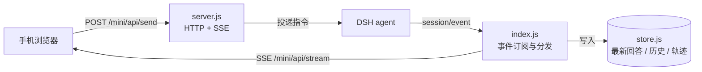

<p align="center">
  
</p>

<h1 align="center">dsh-remote-lite</h1>

<p align="center">
  把 DSH 搬到手机上 —— 局域网直连或 Cloudflare 隧道，扫码即用。
</p>

<p align="center">
  <a href="LICENSE"></a>
  <a href="package.json"></a>
  <a href="package.json"></a>
  <a href="https://github.com/coderxxw/dsh-remote-lite/pulls"></a>
</p>

<p align="center">
  <a href="README.en.md">English</a> | <b>简体中文</b>
</p>

---

`dsh-remote-lite` 是 DSH 的手机遥控插件。它在宿主起一个 HTTP + SSE 服务（默认 `:3090`），手机浏览器扫码即可进入：查看工作区与会话、发送指令、审批工具调用、切换模型与权限档位。在家走局域网，出门走 Cloudflare 隧道，同一个页面，换个地址。

插件**不代理桌面界面**——手机只拿「指令」和「回答」，中间过程按需展开。它也不注册系统服务、不开机自启、不修改 hosts，DSH 退出服务即停。

## 目录

- [特性](#特性)
- [环境要求](#环境要求)
- [安装](#安装)
- [快速开始](#快速开始)
- [使用](#使用)
- [配置](#配置)
- [工作原理](#工作原理)
- [接口](#接口)
- [常见问题](#常见问题)
- [已知限制](#已知限制)
- [路线图](#路线图)
- [参与贡献](#参与贡献)
- [致谢](#致谢)
- [许可证](#许可证)

## 特性

- **两条通路**：局域网明文 HTTP 开箱即用；公网走 Cloudflare 隧道，HTTPS 与固定域名都能有。
- **零命令行配隧道**：填一个 Cloudflare API Token，插件自己建隧道、写 ingress、写 DNS、拉起 `cloudflared`。
- **三档显示**：单帧只看最新一条回答、聊天看完整往返、完整额外展开每一轮的思考与工具调用。
- **完整的遥控面**：发指令（跑着时排队或插话）、斜杠指令、选文件 / 拍照上传、工具审批、向用户提问作答、子智能体查看与追问、模型与权限档位切换。
- **会话导航**：工作区 → 会话树，可新建会话、新建工作区、浏览目录挑位置；插件不在场时直接从会话日志补历史。
- **锁屏推送**：Bark / ntfy / Telegram 三种外部通道，另有基于 service worker 的系统通知（要求 HTTPS）。
- **桌面视图**：内置反代，需要改插件自己的设置时可以把电脑端 GUI 整个搬到手机上看。
- **清理会话**：长按左侧导航里的会话行即可归档这个对话，长按工作区标题可把整个文件夹下的对话一次归档，或直接删除该工作区。
- **可验证的运行态**：`/mini/api/version` 返回构建指纹，能确认「现在应答我的是不是刚改的那份代码」。

## 环境要求

| 依赖 | 版本 |
| --- | --- |
| Node.js | `^22.19.0 \|\| >=24.0.0` |
| DSH | `>=0.1.5-rc.2 <1.0.0` |

不满足时 DSH 会拒绝加载并提示需要精确版本豁免。

## 安装

本包**尚未发布到 npm**，只有两条安装路径，且都必须显式带 `--profile` —— `dsh plugin` 不会替你推断目标 profile。

```sh
# 从 GitHub（跟随 main 最新提交）
dsh plugin --profile web add github:coderxxw/dsh-remote-lite

# 从本地路径（开发用，改代码即时生效）
dsh plugin --profile web add link:/path/to/dsh-remote-lite
```

Windows 上本地路径写作 `link:D:/path/to/dsh-remote-lite`。

装完确认 profile 的 `dsh.profile.bundles` 里有 `dsh-remote-lite`：

```sh
node -e "console.log(require(process.env.HOME + '/.dsh/profiles/web/package.json').dsh.profile.bundles)"
```

数组里没有这个条目，插件就不会加载 —— 而且**不会报错**，只是安静地什么都没发生。

## 快速开始

```sh
dsh web
```

启动日志会打印配对地址：

```
[dsh-remote-lite] 已启动。手机打开下面任意一条（或到 DSH 设置 → 手机遥控 扫码）：
[dsh-remote-lite]   本机  http://127.0.0.1:3090/mini?token=xxxx
[dsh-remote-lite]   内网  http://10.0.0.5:3090/mini?token=xxxx
```

手机与电脑在同一 Wi-Fi 时，直接打开「内网」那条即可；也可以打开 DSH Web 界面 → **设置 → 手机遥控**，扫二维码进入。

要从外网访问，见[配置公网隧道](#配置公网隧道)。

## 使用

### 访问地址

| 通路 | 地址 | 可用范围 | 前提 |
| --- | --- | --- | --- |
| 局域网 | `http://<宿主IP>:3090/mini?token=<口令>` | 同一 Wi-Fi | 无 |
| 公网 | `https://<域名>/mini?token=<口令>` | 任意网络 | Cloudflare 账号 + 域名 |

插件按 `bindAddress: "auto"` 监听所有可用网卡（虚拟网卡会被跳过），本机地址也保留，方便在电脑上打开配对页。口令最短 12 位；未配置时首次启动生成 32 位十六进制串并落盘。口令以查询参数形式出现一次，之后写入 cookie。

### 显示模式

| 模式 | 内容 |
| --- | --- |
| 单帧 | 只留最新一条回答，落定时自动跳到开头 |
| 聊天 | 完整往返记录，回答不套气泡、提问靠右 |
| 完整 | 在聊天基础上，把每轮的思考与工具调用插回原位 |

### 主要操作

| 操作 | 入口 |
| --- | --- |
| 发指令 | 底部输入框，回车发送 |
| 跑步中追加 | 再发一条 —— 排队，或插话到下一步边界（行为可配） |
| 斜杠指令 | 输入 `/` 弹出当前会话可用指令 |
| 附件 | 回形针 → 选文件 / 拍照 |
| 审批与答题 | 桌面端触发时自动弹卡片 |
| 子智能体 | 侧栏面板，可查看、追问、单独停止 |
| 切模型 / 权限 | 顶部状态条与设置抽屉 |
| 归档对话 / 删工作区 | **长按**左侧导航里的会话行或工作区标题 |

## 配置

配置在 `$DSH_HOME/dsh-remote-lite/settings.json`（默认 `~/.dsh/dsh-remote-lite/settings.json`）。最小可用配置：

```json
{
  "port": 3090,
  "bindAddress": "auto",
  "token": ""
}
```

| 字段 | 默认 | 说明 | 改动后 |
| --- | --- | --- | --- |
| `port` | `3090` | 手机访问端口 | 需重载 |
| `bindAddress` | `"auto"` | `auto` / `127.0.0.1` / 具体 IP | 需重载 |
| `token` | 空 | 访问口令，空 = 首次启动自动生成 | 需重载 |
| `maxHistory` | `50` | 每个会话在手机上保留多少条历史 | 需重载 |
| `defaultMode` | `"minimal"` | `minimal` / `chat` / `full` | 即时生效 |
| `tunnel.enabled` | `false` | 是否启公网隧道 | 需重载 |
| `tunnel.mode` | `"quick"` | `quick`（免账号，网址每次变）/ `named`（固定域名） | 需重载 |
| `tunnel.hostname` | 空 | 固定隧道域名，如 `dsh.example.com` | 需重载 |
| `tunnel.apiToken` | 空 | 管理 API Token，用于自动建隧道 | 需重载 |
| `tunnel.tunnelToken` | 空 | 已有隧道的运行令牌，跳过管理 API | 需重载 |
| `notify.*` | 空 | Bark / ntfy / Telegram 推送 | 即时生效 |

### 配置公网隧道

插件需要一份具备以下权限的 Cloudflare API Token：

- `Account → Cloudflare Tunnel → Edit`
- `Zone → DNS → Edit`
- `Zone → Zone → Read`

在设置页粘贴 Token → 点「读取我的域名」→ 选域名并保存。插件随即完成建隧道、写 ingress、写 DNS 记录、拉起 `cloudflared` 四步。

也可以直接填一条**已存在隧道的运行令牌**（`eyJ...` 形式）：这条路跳过全部管理 API 调用，但 DNS 记录需要自行配置。

字段语义、推送通道配法与逐项排查命令见 [docs/SETTINGS.md](docs/SETTINGS.md)。

> 数据目录有一处历史遗留：若 `$DSH_HOME/dsh-mini-remote-lite` 已存在，插件沿用它而不新建 `dsh-remote-lite` —— 换目录名会把已配好的口令与隧道令牌一起丢掉。

## 工作原理



插件订阅 DSH 的 `session/event` 与 `agent/status`，把执行过程重放成手机需要的结构后经 SSE 推送；用户指令通过普通 POST 回注宿主。

<details>
<summary><b>实现细节与源码地图</b></summary>

### 设计取舍

1. **不 import 任何 `@deepseek-ai/*` 的运行时值。** 唯一例外是 `@deepseek-ai/schemastery`，只用于声明 `Config`；它由宿主提供（写在 `peerDependencies`），避免出现第二份副本引发 cordis 双实例问题。
2. **自己起 `node:http`，不挂 `ctx.webServer`。** 宿主 Web 服务只能绑 `127.0.0.1` 或 `0.0.0.0`，把主 GUI 暴露到 `0.0.0.0` 不可接受；插件则需要按配置精确绑定网卡。
3. **SSE 而不是 WebSocket。** 零依赖、`EventSource` 自带断线重连，且只需要服务端→手机单向推送。
4. **流式「事后确认再推」。** `text-delta` 先缓存不外露，一旦出现 `tool-call-delta` 就整段丢弃；直到该步收尾仍无工具调用才确认是最终回答。代价是首字延迟，换来旁白零闪现。

### 源码地图

| 分组 | 文件 | 职责 |
| --- | --- | --- |
| 入口 | `lib/index.js` | `apply` / `Config` / 事件订阅 / 设置面路由 / 隧道编排 |
| 传输 | `lib/server.js` | 移动端 HTTP + SSE 服务 |
| | `lib/page.html` | 移动端单文件页面（约 395 KB 源码） |
| | `lib/page.js` | 页面模板注入与图片资产 |
| | `lib/build.js` | 构建指纹 |
| | `lib/sw.js` | service worker，只为系统通知存在，不缓存请求 |
| 会话数据 | `lib/events.js` | 原始事件 → 可见文本；判定哪一步算最终回答 |
| | `lib/history.js` | 会话日志重放成聊天记录 |
| | `lib/trajectory.js` | 思考、工具调用、结果重放成过程组 |
| | `lib/store.js` | 内存状态，落盘仅为重启后仍可读 |
| | `lib/log-tail.js` | 直读会话日志（含 zstd），补插件不在场时的历史 |
| | `lib/tree.js` | 工作区 → 会话树 |
| | `lib/commands.js` | 斜杠指令事件折叠 |
| 缓存 | `lib/title-cache.js`、`lib/session-meta-cache.js`、`lib/subagent-cache.js` | 标题、会话元数据、子智能体清单 |
| 能力 | `lib/permissions.js` | 权限档位读写 |
| | `lib/browse.js` | 目录浏览与新建 |
| | `lib/notify.js` | Bark / ntfy / Telegram 推送 |
| 隧道 | `lib/tunnel.js` | `cloudflared` 生命周期与就绪判定 |
| | `lib/cloudflared.js` | 二进制查找与下载 |
| | `lib/cloudflare.js` | 建隧道、写 ingress、写 DNS |
| | `lib/net.js`、`lib/pairing.js` | 网卡挑选、配对信息与二维码 |
| 镜像 | `lib/mirror.js` | 反代电脑端 GUI（含 WebSocket 透传） |
| 设置页 | `client/client.js` | DSH 设置里的「手机遥控」标签 |

</details>

## 接口

插件自有服务（`:3090`）上的主要路由：

| 分组 | 路径 |
| --- | --- |
| 页面 | `GET /mini`、`/mini/art/*`、`/mini/sw.js` |
| 状态 | `GET /mini/api/state`、`/stream`、`/history`、`/trajectory`、`/subagents`、`/version` |
| 指令 | `POST /mini/api/send`、`/command`、`/stop`、`/unqueue`、`/upload` |
| 交互 | `POST /mini/api/approval`、`/answer`、`/subagent/ask`、`/set-model`、`/permissions` |
| 导航 | `GET /mini/api/workspaces`、`/browse`、`/browse/roots`；`POST /mini/api/bind`、`/browse/mkdir` |
| 其它 | `GET /mini/api/plugins`、`/models`、`/commands`、`/mirror` |
| 清理 | `POST /mini/api/session/archive`、`/workspace/archive`、`/workspace/delete` |

挂在宿主 Web 服务（默认 `:10001`）、供设置页调用：`/mini-remote/pairing`、`/mini-remote/tunnel`、`/mini-remote/tunnel/zones`、`/mini-remote/tunnel/named`、`/mini-remote/token`。

所有路由都校验口令；设置面那组额外限定只接受本机请求。

## 常见问题

<details>
<summary>插件像没装上</summary>

检查 `dsh.profile.bundles` 里有没有 `dsh-remote-lite`；`link:` 安装时另需确认插件目录下装了 `qrcode` 依赖（`npm install`）。
</details>

<details>
<summary>手机打不开页面</summary>

依次确认：`:3090` 是否处于 LISTEN、Windows 防火墙是否放行「专用网络」、手机与电脑是否同一 Wi-Fi。
</details>

<details>
<summary>页面一直停在「连接中」</summary>

打开 `/mini/api/version?token=<口令>` 看是否返回 200，再看 DSH 日志里 `[dsh-remote-lite]` 开头的行。
</details>

<details>
<summary>隧道连不上</summary>

先关掉电脑上的代理或 VPN（Clash 这类），再对照日志关键词：

| 关键词 | 含义 |
| --- | --- |
| `Registered tunnel connection` | 成功 |
| `Tunnel not found` | 隧道被删了，重建 |
| `Invalid request headers` | Token 类型填错（管理 Token 与隧道令牌混用） |
| `timeout` / `no recent network activity` | 网络层不通，插件已固定 `--protocol http2 --edge-ip-version 4` |
</details>

<details>
<summary>收不到通知</summary>

系统通知要求 HTTPS 安全上下文（公网隧道满足，局域网明文不满足）。不折腾就配 Bark / ntfy / Telegram。
</details>

<details>
<summary>改了代码没变化</summary>

`page.html` 与 `sw.js` 在启动时读进内存，**必须重启 DSH**，重装无用。重启后用构建指纹确认：

```sh
curl -s "http://127.0.0.1:3090/mini/api/version?token=<口令>"
# {"ok":true,"build":"dfa3c69b7b66","dshVersion":"0.2.1-rc.2","canCreateSession":true}
```
</details>

## 已知限制

- 局域网通路为**明文 HTTP**，无传输加密；口令以查询参数传递，不适用于不可信网络。
- 部分网络无法访问 Cloudflare 边缘地址，插件固定 `--protocol http2 --edge-ip-version 4` 规避，但无法覆盖全部环境。
- 隧道的边缘节点由 Cloudflare 决定，跨区域访问可能受链路质量影响。
- 移动端页面是单文件结构，首次加载体积较大 —— 已按 `Accept-Encoding` 协商压缩：395 KB 原文 → brotli 约 110 KB（gzip 约 141 KB）。
- 技能（skills）的列举与取正文接口已在服务端就位（`/mini/api/skills`、`/mini/api/skill`），手机端选择器尚未接入。

## 路线图

- [ ] 手机端技能选择器（`@` 唤起，选中后把正文拼进提示词）
- [ ] 移动端页面分包，降低首屏体积
- [ ] 发布到 npm

## 参与贡献

```sh
git clone https://github.com/coderxxw/dsh-remote-lite.git
cd dsh-remote-lite
npm install
npm run check   # 语法检查
```

开发时建议用 `link:` 方式装进 profile，改代码后重启 DSH 即生效，不需要重装。提交前请让 `npm run check` 通过，并在 PR 里说明改动影响到的通路（局域网 / 隧道 / 镜像）。

## 致谢

源自 [dsh-mini-remote](https://github.com/xingzhen199186/dsh-mini-remote)（[@xingzhen199186](https://github.com/xingzhen199186)），本包在其基础上重构为两条连接通路与零命令行部署。

图标基于 [Twemoji](https://github.com/jdecked/twemoji) 的 🐳（CC-BY 4.0），重新配色为 DeepSeek 品牌蓝（`#4D6BFE`）。DeepSeek 名称与鲸鱼标志归其所有者所有，此处仅作生态归属说明。

## 许可证

[MIT](LICENSE) © [coderxxw](https://github.com/coderxxw)
